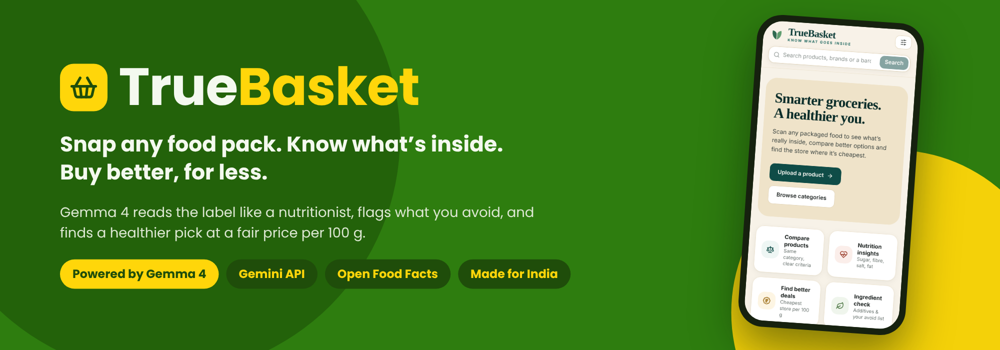
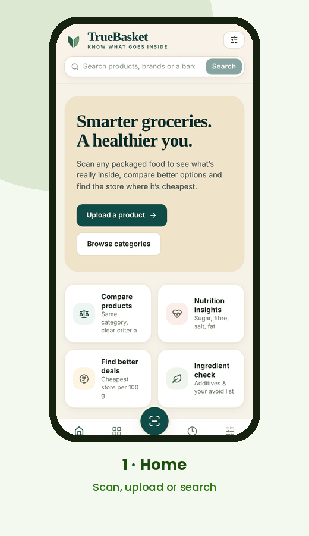
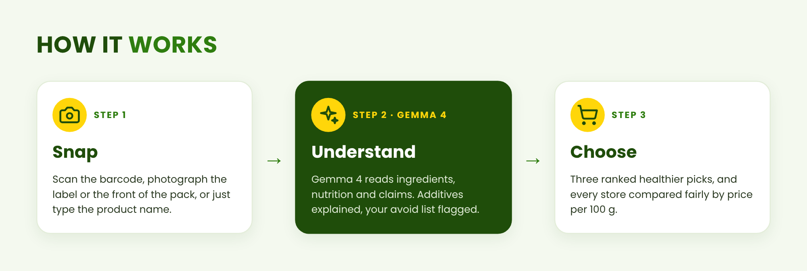
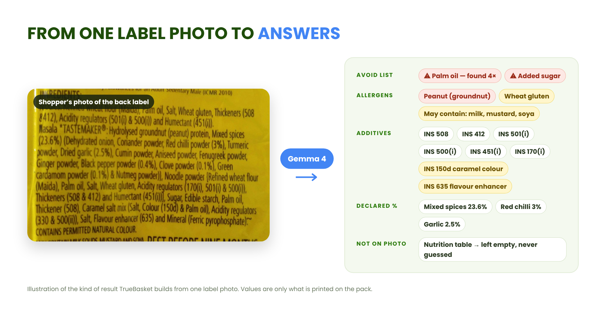
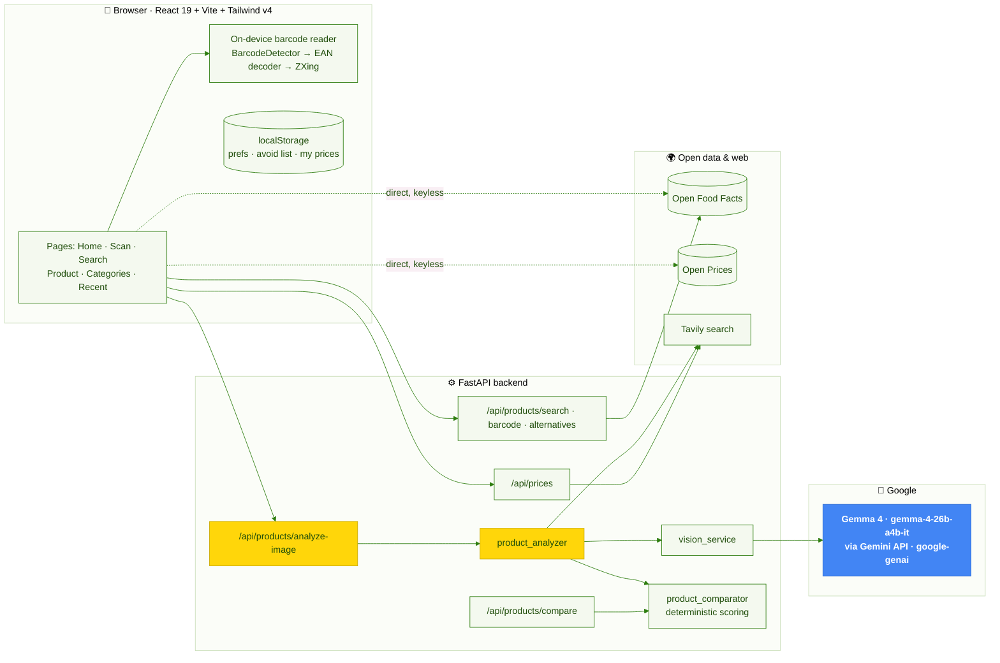
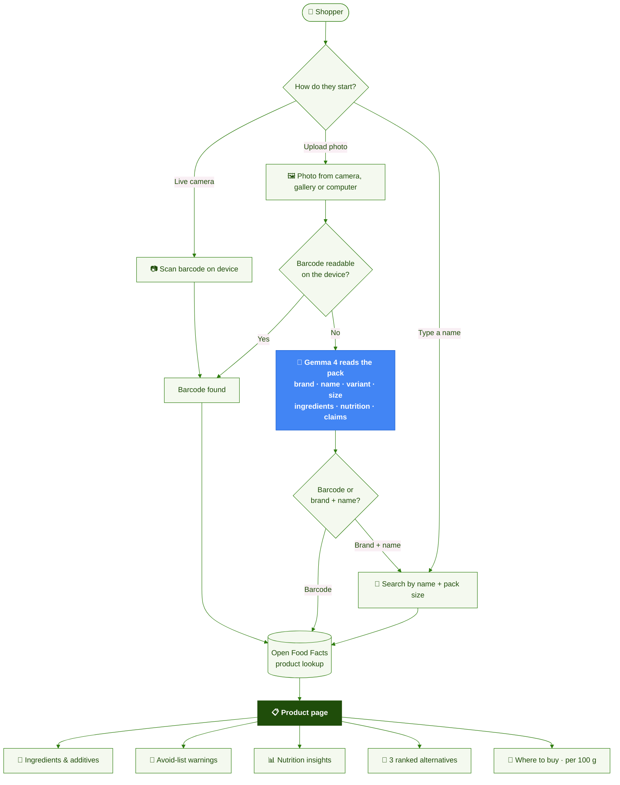
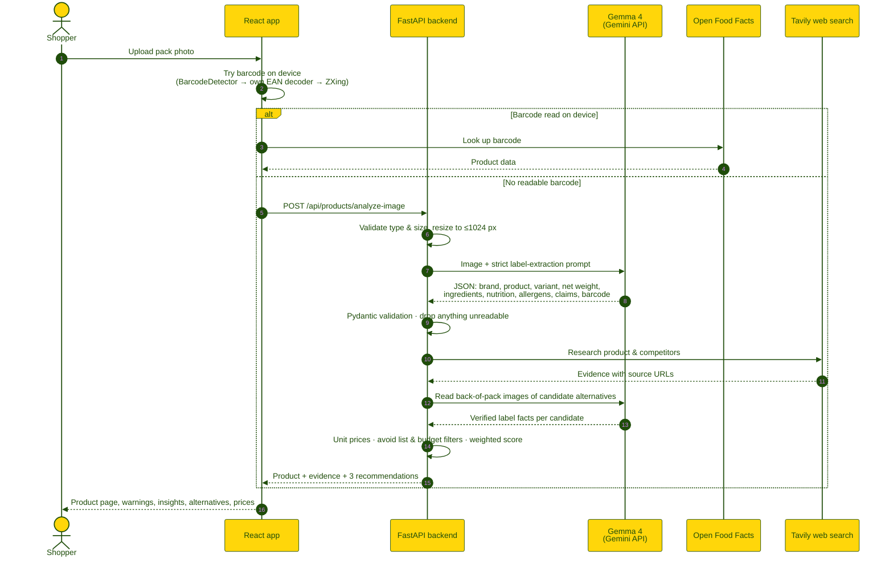
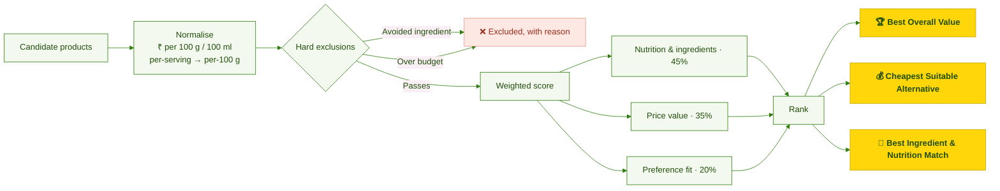

<div align="center">



<br>

[](#-gemma-4-at-the-core)
[](#-gemma-4-at-the-core)
[](truebasket-backend/)
[](truebasket-frontend/)
[](#-testing)
[](LICENSE)

<!-- When deployed, add: [▶ Live demo](https://…vercel.app) · [🎥 Video](https://…) · [📘 API docs](https://…onrender.com/docs) -->
### [🚀 Run it locally](#-run-it-locally) · [🧠 See the Gemma 4 integration](#-gemma-4-at-the-core) · [🎬 Watch it work](#-see-it-in-action)

</div>

---

## ⚡ TL;DR for judges

| | |
|---|---|
| **😩 Problem** | Indian shoppers can't tell what's in packaged food, whether the front-of-pack claims are true, or which of 8 shopping apps is actually cheapest per gram. Barcode apps fail on the many Indian products missing from their databases. |
| **💡 Solution** | Snap the pack — barcode, label or front. TrueBasket explains every ingredient, flags your avoid list, judges nutrition against official thresholds, and ranks healthier alternatives by fair **price per 100 g**. |
| **🧠 Gemma 4** | `gemma-4-26b-a4b-it` via the **Gemini API** (`google-genai` SDK) reads pack photos into structured, validated JSON — the shopper's own pack **and** the back labels of candidate alternatives. [See exactly where ↓](#-gemma-4-at-the-core) |
| **🛡️ Trust** | Never invents a value: anything not printed on the pack stays empty. Every price has a source and a date. |
| **✅ Proof** | Working full-stack app, 86 backend tests, on-device barcode decoder that works in every browser, Swagger docs. |

## 🎬 See it in action

<table>
<tr>
<td width="44%" align="center">

</td>
<td>

**What you're watching**

1. **Home** — scan, upload a photo, or search.
2. **Scan & upload** — live camera, gallery or computer.
3. **Search** — by name, filtered by pack size.
4. **Product analysis** — ingredients in printed order, additives explained, avoid-list warnings, nutrition insights.
5. **Better alternatives** — three ranked picks that respect your avoid list and budget.
6. **Where to buy** — Blinkit, Instamart, Zepto, BigBasket, DMart, JioMart, Amazon and Flipkart, compared per 100 g.

> 📱 Mobile-first and fully responsive. It also works with **no backend at all**, falling back to Open Food Facts directly.

</td>
</tr>
</table>

<div align="center">

</div>

---

## 🧠 Gemma 4 at the core

<div align="center">

</div>

<br>

| | |
|---|---|
| **Model** | **Gemma 4** — `gemma-4-26b-a4b-it` (26B mixture-of-experts, ~4B active parameters, instruction-tuned, multimodal) |
| **Access** | **Gemini API**, through Google's official [`google-genai`](https://pypi.org/project/google-genai/) Python SDK — `genai.Client(...).models.generate_content(...)` |
| **Input** | The shopper's pack photo (resized to ≤ 1024 px) + a strict extraction prompt |
| **Output** | JSON validated by Pydantic: identity, ingredients, declared %, allergens, nutrition table and basis, claims, barcode, FSSAI licence, readability and confidence |

### 📍 Where the model is called — point at the code

| # | File → function | What happens |
|:-:|---|---|
| 1 | [`gemma_service.py` → `_infer_google_genai_multimodal()`](truebasket-backend/app/services/gemma_service.py#L430) · [`genai.Client`](truebasket-backend/app/services/gemma_service.py#L466) · [`generate_content`](truebasket-backend/app/services/gemma_service.py#L480) | **The Gemini API call**: image `Part` + prompt, with timeout, retries and error classification |
| 2 | [`vision_service.py` → `run_vision_image_inference()`](truebasket-backend/app/services/vision_service.py#L59) | Single entry point for vision calls; returns the result with model id and latency |
| 3 | [`product_analyzer.py` → `EXTRACT_VISUAL_LABEL_PROMPT`](truebasket-backend/app/services/product_analyzer.py#L104) | The label-extraction prompt and JSON schema |
| 4 | [`product_analyzer.py` → `extract_product_from_packaging()`](truebasket-backend/app/services/product_analyzer.py#L297) | Identifies the shopper's product from their photo |
| 5 | [`product_analyzer.py` → `analyze_product_image_pipeline()`](truebasket-backend/app/services/product_analyzer.py#L828) | Reads the **back labels of candidate alternatives**, so recommendations rest on label facts, not marketing copy |
| 6 | [`gemma_service.py` → `_infer_google_genai()`](truebasket-backend/app/services/gemma_service.py#L356) | Text-only Gemma 4 calls |

> **🔍 Verify it live in 30 seconds:**
> 1. Open `/docs` on the backend.
> 2. Run **`POST /api/products/analyze-image`** with any food-label photo, and see Gemma 4's structured extraction in the response.
> 3. **`GET /api/health`** shows the active provider and model.

### 🛡️ Five rules that stop hallucination

| Rule | Effect |
|---|---|
| **1. Printed facts only** | Gemma 4 may extract only what is visibly printed and legible — never invent, extrapolate or guess |
| **2. Front-of-pack stays honest** | A front photo returns identity and claims, with an **empty** ingredient list and **null** nutrition |
| **3. No made-up percentages** | Only manufacturer-declared %, e.g. "Rolled Oats (42%)", never estimated from ingredient order |
| **4. Unreadable means unreadable** | Blurred or cut-off text goes into `unreadable_fields` instead of being guessed |
| **5. Know the basis** | Per-100 g vs per-serving is detected, so the backend normalises correctly |

Every response is then **validated by Pydantic**. A candidate alternative's photo counts only if Gemma 4 extracted real label fields from it.

---

## ✨ Features

<table>
<tr>
<td width="33%" valign="top">

### 📷 Scan anything
Live barcode camera, a photo of the barcode, a photo of the **label**, or a name search with a pack-size filter. Our own EAN/UPC decoder works even where the browser has no built-in reader (Firefox, Windows).

</td>
<td width="33%" valign="top">

### 🧠 Gemma 4 label reading
No barcode, or the product isn't in any database? Gemma 4 reads the brand, product, variant, net weight, ingredients, nutrition, allergens, claims and FSSAI licence straight off the pack.

</td>
<td width="33%" valign="top">

### 🔬 Ingredient intelligence
Every ingredient in printed order. Every additive (INS / E-number) explained, linked to its official **EFSA** evaluation where one exists.

</td>
</tr>
<tr>
<td valign="top">

### 🚫 Personal avoid list
Palm oil, added sugar, maltodextrin, peanuts… set once and flagged everywhere, with synonym matching (e.g. *palmolein* → palm oil).

</td>
<td valign="top">

### 📊 Nutrition insights
High sugar, salt and saturated fat, and sources of protein and fibre — judged against **EU 1924/2006** and **UK FSA** thresholds, not vibes.

</td>
<td valign="top">

### 🥇 Better alternatives + 🛒 where to buy
*Best Overall Value*, *Cheapest Suitable*, *Best Ingredient & Nutrition Match*. Prices from 8 Indian stores, normalised **per 100 g**.

</td>
</tr>
</table>

## 👥 Who it helps

_Illustrative scenarios showing how each feature helps a real shopper._

| | Shopper | What TrueBasket does |
|:-:|---|---|
| 🩺 | **Meera**, managing her father's diabetes | Photographs a "no added sugar" muesli. Gemma 4 reads the label; **maltodextrin** from her avoid list is flagged, sugar per 100 g is shown against the threshold, and a lower-sugar alternative is suggested. |
| 🏋️ | **Arjun**, gym-goer | Checks a "High Protein" bar: protein per 100 g from the label sits next to the official threshold, plus alternatives with more protein per rupee. |
| 🥜 | **Sana**, nut allergy in the family | Adds *peanut* once. Every scan afterwards warns her if the ingredients or allergen statements mention it. |
| 🛒 | **Rohit**, budget shopper | "Basmati rice 5 kg" vs "1 kg" across apps finally becomes comparable: everything is shown as **₹ per 100 g**. |
| 🏷️ | **A regional brand no database knows** | Instead of "product not found", the shopper photographs the label and **Gemma 4 reads it**. |

## 🆚 Why TrueBasket is different

| | Typical barcode-scanner app | **TrueBasket** |
|---|:-:|:-:|
| Works when the product isn't in a database | ❌ | ✅ Gemma 4 reads the pack |
| Understands a photo of the label or front | ❌ | ✅ |
| Personal avoid list with synonyms | Sometimes | ✅ |
| Explains every additive, with official sources | Sometimes | ✅ EFSA links |
| Healthier alternatives that respect your avoid list & budget | Rarely | ✅ 3 ranked picks |
| Fair price comparison per 100 g across Indian stores | ❌ | ✅ 8 stores |
| Refuses to guess missing data | — | ✅ by design |

---

## 🏗 Architecture



### The shopper's journey



<details>
<summary><b>🔎 Step by step: what happens inside one photo analysis</b></summary>



</details>

## ⚖️ The comparison engine

Alternatives are ranked by **deterministic, explainable code** ([`product_comparator.py`](truebasket-backend/app/services/product_comparator.py)), not by an LLM's opinion.



**Nutrition thresholds used** (all per 100 g):

| Insight | Threshold | Source |
|---|---|---|
| High sugar | > 22.5 g | UK FSA front-of-pack |
| High saturated fat | > 5 g | UK FSA front-of-pack |
| High salt | > 1.5 g | UK FSA front-of-pack |
| Low sugar | ≤ 5 g | EU Reg. 1924/2006 |
| Source of fibre / high fibre | ≥ 3 g / ≥ 6 g | EU Reg. 1924/2006 |

## 🤝 Honesty by design

- **🚫 No invented data.** Anything Gemma 4 can't read is `null`, and the UI says *"Not on the label"*.
- **💸 No invented prices.** Every price has a source (Open Prices, a retailer page found by web search, or your own entry) and a date. Store buttons say *"Search on …"*, not a price.
- **🔗 Sources shown.** Evidence URLs come with every analysis, classified as official, regulator or retailer/web.
- **🔐 Keys stay on the server.** Gemini and Tavily keys live only in the backend `.env`. The health endpoint never echoes secrets, and tests check that it doesn't.
- **🧪 Synthetic data stays in tests.** Great Generator fixtures never reach users.

---

## 🧰 Tech stack

<div align="center">


</div>

| Layer | Technology |
|---|---|
| **AI** | **Gemma 4** `gemma-4-26b-a4b-it` via the **Gemini API**, using the **Google Gen AI SDK** (`google-genai`) |
| **Backend** | Python 3.11+, FastAPI, Uvicorn, Pydantic v2 + pydantic-settings, HTTPX (async), Pillow |
| **Data** | Open Food Facts (products, categories, additives), Open Prices (community prices), Tavily (web evidence) |
| **Frontend** | React 19, Vite 6, Tailwind CSS v4, lucide-react, @zxing/library |
| **Barcodes** | BarcodeDetector → custom EAN-13 / EAN-8 / UPC-A decoder → ZXing, with rotation retries |
| **Quality** | Pytest + pytest-asyncio (86 tests), Great Generator synthetic fixtures |
| **Deploy** | Render (backend), Vercel (frontend) |

---

## 🚀 Run it locally

> **You need:** Python 3.11+, Node.js 20+, a free [Google AI Studio](https://aistudio.google.com/) API key, and optionally a [Tavily](https://tavily.com/) key.

**1 · Backend**

```bash
git clone https://github.com/Arghaneel/TrueBasket.git
cd TrueBasket/truebasket-backend
python -m venv .venv && source .venv/bin/activate     # Windows: .\.venv\Scripts\Activate.ps1
pip install -r requirements.txt
cp .env.example .env
```

Set these in `.env`, so that Gemma 4 runs through the Gemini API:

```env
AI_VISION_PROVIDER=google
GEMMA_PROVIDER=google
GEMMA_MODEL=gemma-4-26b-a4b-it
GEMMA_API_KEY=your_google_ai_studio_key
TAVILY_API_KEY=your_tavily_key
CORS_ORIGINS=http://localhost:5173
```

```bash
uvicorn app.main:app --reload --port 8000       # → http://localhost:8000/docs
python -m app.services.gemma_service           # optional: Gemma 4 smoke test
```

**2 · Frontend**

```bash
cd ../truebasket-frontend
npm install
cp .env.example .env      # set VITE_API_URL=http://localhost:8000 and VITE_PRICE_API_URL=http://localhost:8000
npm run dev               # → http://localhost:5173
```

> ⚠️ **Never put API keys in the frontend `.env`.** Every `VITE_*` value is visible in the browser.

**3 · Try it in 60 seconds**

1. Open **Preferences** and add *palm oil* and *added sugar* to your avoid list.
2. Search **"muesli"**, pick a 500 g pack, and explore Ingredients → Nutrition → Alternatives → Where to buy.
3. Go to **Scan**, upload a label photo with no visible barcode, and tap **"Read the label with Gemma 4"**.

---

<details>
<summary><b>📡 API reference</b></summary>

<br>

Interactive docs are at `/docs`. The frontend contract is in [`truebasket-frontend/docs/BACKEND_API.md`](truebasket-frontend/docs/BACKEND_API.md).

| Method | Endpoint | Purpose |
|---|---|---|
| `GET` | `/api/health` | Status of Gemma 4, vision and Tavily (never returns secrets) |
| `POST` | `/api/products/analyze-image` | **Gemma 4** pack-photo analysis → product, evidence, 3 recommendations |
| `POST` | `/api/products/compare` | Deterministic ranking of supplied alternatives |
| `GET` | `/api/products/search?q=` | Open Food Facts search proxy |
| `GET` | `/api/products/barcode/{barcode}` | Barcode lookup proxy |
| `GET` | `/api/products/alternatives?categories_tags=` | Category alternatives |
| `GET` | `/api/prices?barcode=&query=&pincode=` | Retailer price evidence, each with source URL and timestamp |
| `POST` | `/api/dev/extract-label` | Gemma 4 label extraction from an upload or URL (diagnostics) |

```bash
curl -F "image=@label.jpg" -F "priority=balanced" -F 'avoid_ingredients=["palm oil"]' \
     http://localhost:8000/api/products/analyze-image
```

</details>

<details>
<summary><b>🧪 Testing</b></summary>

<br>

```bash
cd truebasket-backend && pytest -v
```

**86 test cases** cover:
- Gemma 4 configuration and JSON extraction;
- failure handling (auth, rate limits, timeouts, empty responses);
- image-first verification;
- the comparator (unit prices, exclusions, scoring, slots);
- the Tavily client;
- health and secret-leak checks;
- frontend contract compatibility.

**Synthetic data with Great Generator.** [`app/testing/great_generator.py`](truebasket-backend/app/testing/great_generator.py) builds schema-valid fixtures — products, label extractions, alternatives, retailer listings and test images — so the pipeline is tested offline without a single production record. The approach follows [Great Data Labs · great-generator](https://github.com/ravikiranpagidi/great-generator).

The frontend was also verified end to end in a headless browser on desktop and mobile layouts.

</details>

<details>
<summary><b>📂 Repository structure</b></summary>

```text
TrueBasket/
├── truebasket-backend/
│   ├── app/
│   │   ├── main.py                    # FastAPI app, routes, CORS, error handlers
│   │   ├── config.py · schemas.py     # settings, Pydantic models
│   │   ├── services/
│   │   │   ├── gemma_service.py       # ⭐ Gemma 4 via Gemini API (google-genai)
│   │   │   ├── vision_service.py      # unified vision entry point
│   │   │   ├── product_analyzer.py    # extraction → research → recommendations
│   │   │   ├── product_comparator.py  # unit prices, exclusions, weighted scoring
│   │   │   ├── image_search.py        # safe candidate-image download
│   │   │   ├── web_search.py          # Tavily client
│   │   │   └── openrouter_service.py  # optional fallback provider
│   │   └── testing/great_generator.py # synthetic fixtures (tests only)
│   ├── tests/                         # 86 pytest cases
│   └── requirements.txt · render.yaml · Procfile · .env.example
├── truebasket-frontend/
│   ├── src/ pages · components · services · lib · hooks · config
│   ├── docs/ BACKEND_API.md · screenshots/
│   └── package.json · vite.config.js · vercel.json
├── docs/assets/                       # README visuals
├── LICENSE
└── README.md
```

</details>

<details>
<summary><b>☁️ Deployment</b></summary>

<br>

| Part | Platform | Setup |
|---|---|---|
| Backend | **Render** | [`render.yaml`](truebasket-backend/render.yaml) included. Secrets: `GEMMA_API_KEY`, `TAVILY_API_KEY`. Also set `AI_VISION_PROVIDER=google` and `CORS_ORIGINS=<your Vercel URL>` |
| Frontend | **Vercel** | [`vercel.json`](truebasket-frontend/vercel.json) included. Root directory `truebasket-frontend`; set `VITE_API_URL` and `VITE_PRICE_API_URL` to the Render URL |

</details>

<details>
<summary><b>🖼️ More screenshots</b></summary>

| Product analysis | Alternatives | Where to buy |
|---|---|---|
|  |  |  |

</details>

---

## 🧭 Limitations & roadmap

**What we're upfront about**

- **Live retailer prices:** Blinkit, Instamart and DMart have no public price APIs. Today, prices come from Open Prices, your own entries and web-search evidence. The `/api/prices` endpoint is ready for licensed feeds (Amazon PA-API, Flipkart Affiliate, ONDC).
- **Open Food Facts coverage of Indian products is uneven.** That's exactly why Gemma 4 label reading matters.

**Next up**

- [ ] **Claim checker** — mark front-of-pack claims ✅ supported / ⚠️ misleading against the nutrition table
- [ ] **Multi-photo scans** — front + back + nutrition panel in one go
- [ ] **Multilingual explanations** by Gemma 4 — Hindi, Tamil, Bengali, Kannada…
- [ ] **Accuracy benchmark** — Gemma 4 on 50 real Indian packs, with a measured hallucination rate
- [ ] **Give back** — contribute Gemma-read products to Open Food Facts, with the shopper's consent

## 👩‍💻 Team

<!-- TODO: add names and GitHub handles -->
| Name | Role |
|---|---|
| _Your name_ | Frontend, product & design |
| _Teammate_ | Backend, Gemma 4 integration, data |

## 🙏 Acknowledgements

- [**Google Gemma 4**](https://ai.google.dev/gemma) and the **Gemini API**
- [**Open Food Facts**](https://world.openfoodfacts.org) & [**Open Prices**](https://prices.openfoodfacts.org) — open food data from thousands of contributors (ODbL)
- [**Great Data Labs · great-generator**](https://github.com/ravikiranpagidi/great-generator) — schema-driven synthetic data
- [**Tavily**](https://tavily.com), [**ZXing**](https://github.com/zxing-js/library), [**Lucide**](https://lucide.dev)

## 📄 License

[MIT](LICENSE). Product data from Open Food Facts is available under the Open Database License.

<div align="center">
<br>

**Built with 💚 and Gemma 4 for the MLH × Google Gemma 4 hackathon**

<sub>If TrueBasket helped you read a label today, give it a ⭐</sub>

</div>
