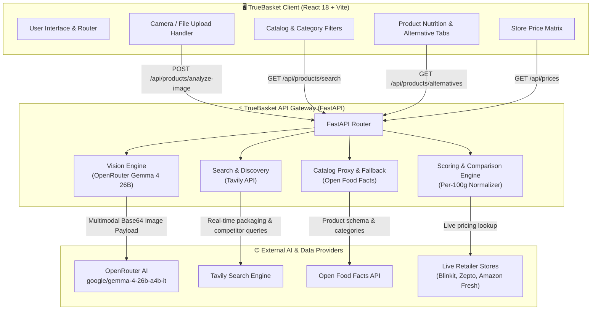
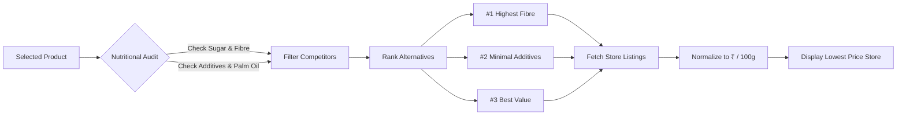
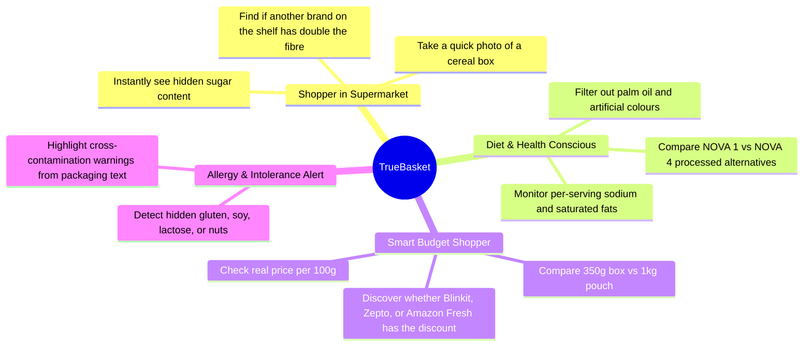

# 🥑 TrueBasket — AI-Powered Food Intelligence & Smart Grocery Comparison

<div align="center">

[](https://fastapi.tiangolo.com)
[](https://react.dev)
[](https://vitejs.dev)
[](https://openrouter.ai)
[](https://tavily.com)
[](https://world.openfoodfacts.org)

**Know what goes inside. Compare real nutrition. Shop smarter with transparent price-per-100g discovery.**

[Features](#-key-features) • [System Architecture](#-system-architecture) • [Workflow Pipelines](#-workflow-pipelines) • [Use Cases](#-real-world-use-cases) • [API Contracts](#-backend-api-contracts) • [Quickstart](#-quickstart-guide)

</div>

---

## 📖 Overview

Packaged food labels are notorious for misleading marketing: *"High Fibre"* claims hiding 30% refined sugar, *"Natural"* granola baked in palm oil, and *"Zero Added Sugar"* snacks packed with artificial maltodextrin. Furthermore, quick-commerce platforms obfuscate true costs across different pack sizes.

**TrueBasket** solves this with an end-to-end multimodal grocery intelligence assistant:
1. **Multimodal Package Understanding:** Snap or upload any grocery package. **Gemma 4** (`google/gemma-4-26b-a4b-it`) extracts brand names, ingredient panels, declared percentages, and nutritional declarations.
2. **Deep Food Knowledge:** Direct integration with **Open Food Facts** provides instant Nutri-Score (A through E), NOVA food-processing level (1 to 4), and additive safety ratings.
3. **Evidence-Based Healthier Alternatives:** The engine searches for competitor products in the same category, parses their real packaging labels, and ranks alternatives (e.g., *#1 More Fibre*, *#2 Fewer Additives*, *#3 Lower Sugar*).
4. **Transparent Price Intelligence:** Uses live web pricing across quick-commerce stores (Blinkit, Zepto, Instamart, Amazon Fresh) to calculate the real cost per 100g, showing exactly where to buy for the lowest price.

---

## 🌟 Key Features

| Feature | Description |
| :--- | :--- |
| 📸 **Multimodal Label Extraction** | Upload a photo of the front or back of any food package. The vision model analyzes OCR text, barcode numbers, brand, and ingredient percentages. |
| 🔍 **Full-Catalog Search** | Search through 10,000+ Indian and global products by brand, category (muesli, cereals, snacks, dairy), or barcode. |
| 🌿 **Transparent Ingredient Breakdown** | Categorizes every ingredient (main grains, sweetening agents, oils, preservatives, emulsifiers) and flags hidden allergens or palm oil. |
| ⚖️ **Algorithmic Alternative Ranking** | Unbiased health ranking without paid sponsorships. Products are evaluated strictly on sugar, protein, fibre, and NOVA ultra-processing tiers. |
| 💰 **Unit-Price (Per 100g) Comparison** | Normalizes prices across 250g, 500g, and 1kg bags so you never overpay for small convenience packaging. |
| 🛡️ **Custom Dietary Profiles** | Set personal preferences: Avoid Palm Oil, Gluten-Free, Vegan, High Fibre ($\ge 6\text{g}$), or Low Sugar ($\le 5\text{g}$). |

---

## 🏛️ System Architecture



---

## 🔄 Workflow Pipelines

### 1. Image Scan & Product Intelligence Pipeline

```mermaid
sequenceDiagram
    autonumber
    actor User as Shopper
    participant UI as TrueBasket Web UI
    participant Backend as FastAPI Backend
    participant Gemma as Gemma 4 (OpenRouter)
    participant OFF as Open Food Facts
    participant Tavily as Tavily Web Search

    User->>UI: Uploads package photo (JPG/PNG/WebP)
    UI->>UI: Check for optical barcode in browser
    alt Barcode recognized locally
        UI->>Backend: GET /api/products/barcode/{barcode}
        Backend->>OFF: Fetch product record
        Backend-->>UI: Return product details
    else No barcode on front of pack
        UI->>Backend: POST /api/products/analyze-image (Multipart)
        Backend->>Backend: Validate MIME type & resize (max 1536px)
        Backend->>Gemma: Multimodal chat completion (base64 image)
        Gemma-->>Backend: JSON: {brand, product_name, ingredients, nutrition}
        Backend->>Tavily: Discover competitor products in same category
        Tavily-->>Backend: Return candidate products & packaging images
        Backend->>Gemma: Extract competitor nutrition & ingredients
        Backend->>Backend: Score & rank alternatives (Fibre, Sugar, Value)
        Backend-->>UI: Return OriginalProduct + Ranked Alternatives
        UI-->>User: Display Product Card & Health Badges
    end
```

### 2. Smart Alternative & Price Comparison Flow



---

## 🎯 Real-World Use Cases



---

## 🔌 Backend API Contracts

All endpoints are hosted by default on `http://localhost:8000`.

### 1. Health Status
- **Endpoint:** `GET /api/health`
- **Purpose:** Verifies configuration status of OpenRouter Vision, Tavily Search, and Gemma LLM.
- **Sample Response:**
```json
{
  "status": "ok",
  "app_name": "TrueBasket Backend API",
  "version": "0.1.0",
  "services": {
    "vision": {
      "configured": true,
      "status": "ready",
      "model": "google/gemma-4-26b-a4b-it"
    },
    "tavily": {
      "configured": true,
      "status": "ready"
    }
  }
}
```

### 2. Image Analysis
- **Endpoint:** `POST /api/products/analyze-image`
- **Content-Type:** `multipart/form-data`
- **Fields:**
  - `image`: Image file (JPG, PNG, WebP)
  - `priority`: `best_value` | `lower_sugar` | `higher_fibre`
  - `avoid_ingredients`: JSON array (e.g. `["palm oil", "maltodextrin"]`)
- **Sample Response:**
```json
{
  "original_product": {
    "brand": "True Elements",
    "product_name": "Muesli No Added Sugar",
    "name": "Muesli No Added Sugar",
    "net_weight": "1 Kg",
    "ingredient_list": ["Rolled Oats", "Wheat Flakes", "Dried Fruits", "Nuts"],
    "nutrition_facts": {
      "energy_kcal": 425,
      "protein_g": 13.5,
      "sugar_g": 4.2,
      "fibre_g": 10.8
    }
  },
  "recommendations": [
    {
      "rank": 1,
      "reason": "Higher fibre content with 0g added sugar",
      "badge": "More fibre"
    }
  ]
}
```

### 3. Product Search & Catalog Proxy
- **Endpoint:** `GET /api/products/search?q={query}&page=1&page_size=24`
- **Purpose:** Fast, resilient search across Open Food Facts with automatic upstream fallback.

### 4. Live Multi-Store Prices
- **Endpoint:** `GET /api/prices?query={product_name}&barcode={code}`
- **Purpose:** Retrieves verified store listings, packaging size, and unit price per 100g.

---

## 🛠️ Tech Stack & Directory Structure

```
TrueBasket/
├── README.md                      # Complete Project Documentation & System Guides
├── .gitignore                     # Git rules (excludes secrets, venvs, node_modules)
│
├── truebasket-backend/            # ⚡ FastAPI Service
│   ├── app/
│   │   ├── main.py                # FastAPI endpoints & CORS configuration
│   │   ├── config.py              # Environment variable loader
│   │   ├── schemas.py             # Pydantic v2 data models
│   │   └── services/
│   │       ├── openrouter_service.py # Gemma 4 26B vision client (OpenRouter)
│   │       ├── vision_service.py     # Vision dispatch & preprocessing
│   │       ├── product_analyzer.py   # Label parser & health evaluator
│   │       ├── product_comparator.py # Alternative comparison & ranking
│   │       └── web_search.py         # Tavily web search integration
│   ├── tests/                     # Live E2E test suite
│   ├── requirements.txt           # Python dependencies
│   ├── Procfile                   # Cloud deployment command
│   └── render.yaml                # Render platform blueprint
│
└── truebasket-frontend/           # 🖥️ React 18 + Vite Web App
    ├── src/
    │   ├── App.jsx                # Main application & routing
    │   ├── components/            # UI Panels (UploadCard, NutritionPanel, etc.)
    │   ├── pages/                 # HomePage, ScanPage, ProductPage, SearchPage
    │   ├── services/              # API clients (api.js, openFoodFacts.js)
    │   └── index.css              # Custom design system
    ├── package.json               # Frontend dependencies
    └── vite.config.js             # Vite build configuration
```

---

## 🚀 Quickstart Guide

### 1. Prerequisites
- **Python 3.10+**
- **Node.js 18+** & `npm`
- An **OpenRouter API Key** (for Gemma 4 Vision)
- A **Tavily API Key** (for web competitor & price discovery)

### 2. Backend Setup
```bash
# 1. Navigate to the backend directory
cd truebasket-backend

# 2. Create and activate a virtual environment
python -m venv .venv
# On Windows:
.\.venv\Scripts\Activate.ps1
# On macOS / Linux:
source .venv/bin/activate

# 3. Install dependencies
pip install -r requirements.txt

# 4. Set up environment variables
cp .env.example .env
# Edit .env and enter your credentials:
# OPENROUTER_API_KEY=sk-or-v1-...
# TAVILY_API_KEY=tvly-...
# AI_VISION_PROVIDER=openrouter
# OPENROUTER_VISION_MODEL=google/gemma-4-26b-a4b-it

# 5. Start the backend server
uvicorn app.main:app --reload --port 8000
```
Backend will be live at `http://127.0.0.1:8000` (API Docs at `http://127.0.0.1:8000/docs`).

### 3. Frontend Setup
```bash
# 1. Open a new terminal and navigate to frontend directory
cd truebasket-frontend

# 2. Install dependencies
npm install

# 3. Create .env file
cp .env.example .env
# Default contents:
# VITE_API_URL=http://localhost:8000

# 4. Start the frontend development server
npm run dev
```
Open `http://localhost:5173` in your browser.

---

## 🧪 Running the Tests

Run the backend verification suite to validate all live integrations:

```bash
cd truebasket-backend

# 1. Test backend health and provider configurations
pytest tests/test_health.py -v

# 2. Test OpenRouter Gemma 4 Vision integration
pytest tests/test_openrouter_vision.py -v

# 3. Test frontend API contracts
pytest tests/test_frontend_integration.py -v
```

---

## 📜 License & Ethics

TrueBasket is open-source under the **MIT License**.
All nutrition scoring and alternative rankings are calculated objectively using public health standards (Nutri-Score, NOVA group, and FSSAI standards). No commercial brands pay for ranking placement.
