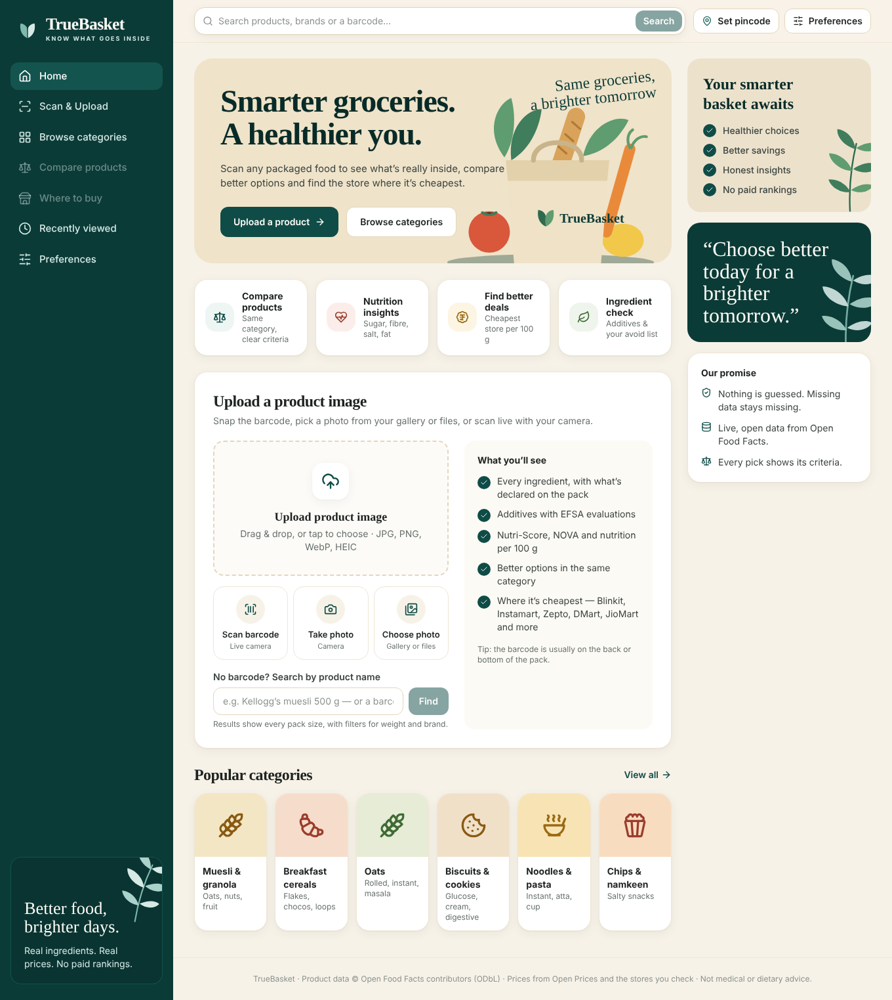
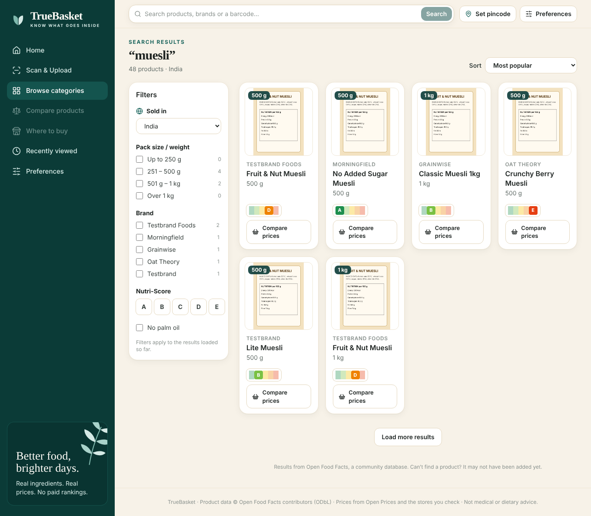
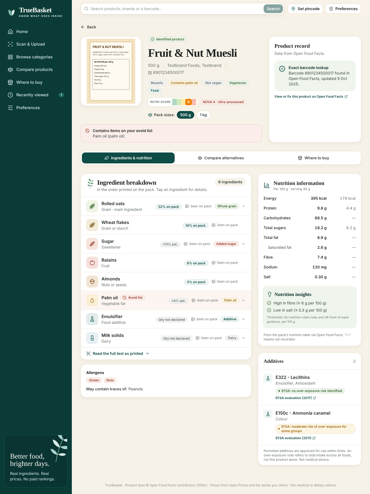
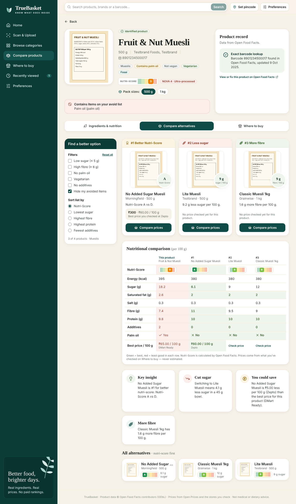
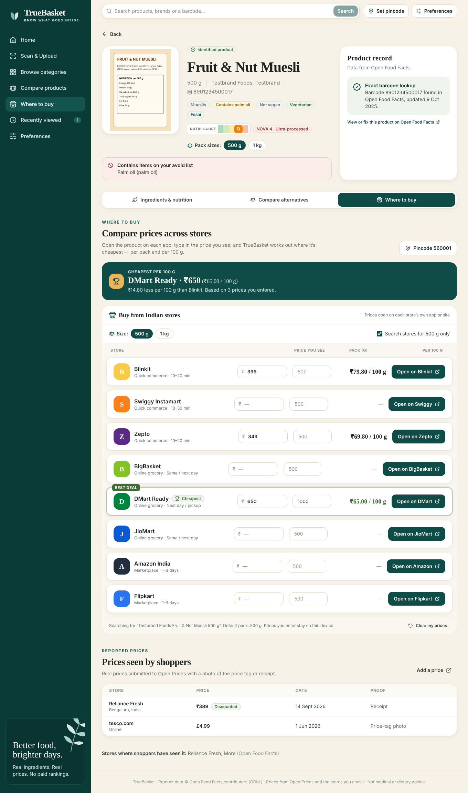
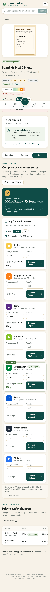

<div align="center">

# TrueBasket

### Know what’s in the box — before it’s in your basket.

**Look up any packaged food in the world, understand every ingredient, compare better options, and find the store where it’s cheapest.**

`React 19` · `Vite 6` · `Tailwind CSS v4` · `Lucide` · `Open Food Facts` · `Open Prices` · `Gemma 4 (optional backend)`

</div>

---

## Contents

1. [What it does](#what-it-does)
2. [Screenshots](#screenshots)
3. [Quick start](#quick-start)
4. [Where the data comes from](#where-the-data-comes-from)
5. [Price comparison: Blinkit, Instamart, Zepto, DMart, JioMart…](#price-comparison)
6. [Connecting a shopping site’s price API](#connecting-a-shopping-sites-price-api)
6. [Environment variables](#environment-variables)
7. [Optional backends](#optional-backends)
8. [Project structure](#project-structure)
9. [Trust principles](#trust-principles)
10. [Testing](#testing)
11. [Deploying](#deploying)
12. [Roadmap](#roadmap)

---

## What it does

| Page | What you get |
| --- | --- |
| **Search** | Search **3M+ packaged foods worldwide** by name, brand or barcode — like a shopping site.<br>• Every card shows its **pack size**.<br>• Filters: **weight**, **brand**, **Nutri-Score** and palm oil.<br>• Sort by popularity, Nutri-Score or size.<br>• A “Compare prices” button on each card.<br>• Product pages list **other pack sizes** of the same product. |
| **Scan & upload** | Four ways in:<br>• **Scan barcode** — live camera<br>• **Take photo** — phone camera<br>• **Choose photo** — gallery, Photos or your computer’s file explorer<br>• **Drag & drop**<br>The barcode (EAN-13 / EAN-8 / UPC) is decoded in the browser. Or type the number, or — with the Gemma 4 backend connected — have the label read. |
| **Ingredients & nutrition** | Every ingredient in order, with **declared %** (from the pack) or **estimated %** (clearly marked), palm oil / vegan flags, sub-ingredients, allergens and traces. Nutrition per 100 g and per serving. **Additives** with their function and **EFSA evaluation** links and over-exposure notes. **Nutri-Score** and **NOVA** processing group. |
| **Compare alternatives** | Products from the same category, ranked #1–#4 for:<br>• better Nutri-Score<br>• less sugar<br>• more fibre<br>• fewer additives<br>Each pick shows the exact numbers. A colour-coded comparison table (green = best, red = least good) and key insights. Filters: low sugar, high fibre, no palm oil, vegetarian, no additives, and your avoid list. |
| **Where to buy** | Pick the **size** to compare (other pack sizes are one tap away); store searches include the weight unless you turn it off. |
| **Where to buy (stores)** | One-tap links to the product on **Blinkit, Swiggy Instamart, Zepto, BigBasket, DMart Ready, JioMart, Amazon India and Flipkart**. Type the price you see on each and TrueBasket tells you **which store is cheapest — per pack and per 100 g — and how much you save**. Plus **real shopper-reported prices** from Open Prices. |
| **Preferences** | Country, delivery pincode and an **avoid list** (e.g. palm oil, sugar, gluten). Saved on your device; matched against every product you open. |

Shareable URLs for everything, e.g. `/#/product/8901058000000?tab=buy` or `/#/search?q=muesli`.

## Screenshots

| Home | Search |
| --- | --- |
|  |  |
| **Ingredients & nutrition** | **Alternatives** |
|  |  |
| **Where to buy** | Pick the **size** to compare (other pack sizes are one tap away); store searches include the weight unless you turn it off. |
| **Where to buy (stores)** | **Mobile** |
|  |  |

<sub>Screenshots were captured with test responses in Open Food Facts format (product names like “Testbrand” are test fixtures). In the running app, all data is live.</sub>

## Quick start

Requirements: **Node.js 18+** (20 or 22 recommended).

```bash
cd truebasket-frontend
npm install
npm run dev          # → http://localhost:5173
```

That’s it — **no API keys and no backend are required.** Product and price data load live from Open Food Facts and Open Prices.

| Command | What it does |
| --- | --- |
| `npm run dev` | Development server with hot reload |
| `npm run build` | Production build into `dist/` |
| `npm run preview` | Serve the production build |
| `npm run lint` | ESLint |

## How barcode reading works

Barcodes are read entirely in the browser — photos never leave your device unless you choose Gemma label reading. Three readers are tried in order:

1. **The browser’s built-in `BarcodeDetector`** — Chrome on Android, macOS and ChromeOS, plus recent Safari.
2. **TrueBasket’s own EAN/UPC decoder** ([`src/lib/barcodeDecoder.js`](src/lib/barcodeDecoder.js)).
   - Scans many lines horizontally and vertically, at three image sizes.
   - Handles blur by sharpening each line.
   - Requires two scan lines to agree before it accepts a code.
3. **[ZXing](https://github.com/zxing-js/library)** (`@zxing/library`) — a deeper scan, loaded only if needed.
4. **Rotated retries** for tilted photos (±22°, ±45°).

Desktop Chrome on Windows/Linux and Firefox have no built-in reader, which is why steps 2–4 exist.

On simulated phone photos (small in frame, rotated, blurred, noisy, uneven light, JPEG-compressed), the built-in decoder read 29 of 29 correctly. It returned no wrong numbers, and found no false barcodes in images without one.

Live camera scanning needs **https** or **localhost** — a browser rule for camera access.

## Where the data comes from

| Source | Used for | Notes |
| --- | --- | --- |
| [Open Food Facts](https://world.openfoodfacts.org) | Product search, barcode lookup, ingredients, nutrition, allergens, additives, Nutri-Score, NOVA, categories, alternatives | Free, open (ODbL), community-built. Fair-use limits: ~10 searches/min and ~15 product reads/min per user, so the app searches on Enter (not on every keystroke) and caches results for 10 minutes. |
| [OFF additives taxonomy](https://static.openfoodfacts.org/data/taxonomies/additives.json) | Additive names, functions, EFSA evaluation links and over-exposure risk | Loaded once, only when a product has additives. |
| [Open Prices](https://prices.openfoodfacts.org) | Real prices reported by shoppers, each with a receipt or price-tag photo | Coverage in India is still small; the app says so when there are none. |
| Retailer search pages | “Open on Blinkit / Instamart / …” | Links open the retailer’s own search for brand + name + size. |

If a product is missing or wrong, the product page links straight to it on Open Food Facts, where anyone can add or fix it.

## Price comparison

**Why prices aren’t pulled automatically from Blinkit, Instamart, Zepto, DMart or JioMart:**
- none of them provide a public price API;
- their prices and stock depend on your pincode and change through the day;
- their terms don’t allow automated scraping.

So TrueBasket does not guess or scrape prices. Instead it offers three honest sources:

1. **Your own check (works today).** Each store has an *Open on …* button. You type in the price you see (and the pack size if it differs), and TrueBasket:
   - ranks stores by **price per 100 g** (or by total price when pack sizes aren’t known);
   - shows the **cheapest store** and **how much you save** versus the most expensive one;
   - saves your entries on your device for that product.
2. **Open Prices (works today).** Real, dated shopper reports with proof.
3. **Live price feed (optional).** If you get an authorised feed (retailer partnership, affiliate programme or a licensed data provider), serve it from your backend and set `VITE_PRICE_API_URL`. Those listings then show up as live prices and join the cheapest-store calculation. See [Optional backends](#optional-backends).

Retailer links live in [`src/config/retailers.js`](src/config/retailers.js). Add a store or fix a URL there.

## Connecting a shopping site’s price API

**Yes — Where to buy and Compare alternatives both work with live prices once a price API is connected.**

The frontend already calls `GET {VITE_PRICE_API_URL}/api/prices` for:
- the product you’re viewing;
- each ranked alternative.

Live listings are merged with prices users type in, and TrueBasket then shows:
- the **cheapest store per 100 g** for this product;
- a **“Best price / 100 g” row** in the comparison table;
- **“You could save ₹X per 100 g”** when an alternative is cheaper.

Nothing changes in the frontend when you add a retailer — you only add an adapter on the backend.

```
Browser ──► your FastAPI price service ──► retailer adapters (keys stay on the server)
              /api/prices?barcode&query&pincode     ├─ Amazon (Product Advertising API)
                                                     ├─ Flipkart (Affiliate API)
                                                     ├─ ONDC buyer-side integration
                                                     └─ any partner feed you have rights to
```

Realistic sources in India:

| Source | Status | What you need |
| --- | --- | --- |
| **Amazon India** — Product Advertising API | Public API with prices | An approved Amazon Associates account and a PA-API application, following their licence terms |
| **Flipkart** — Affiliate API | Product feeds and keyword / product-ID search | A Flipkart Affiliate account and API token |
| **ONDC** network | Open protocol; grocery sellers publish catalogues | Building or partnering with an ONDC buyer-app integration |
| **Blinkit, Swiggy Instamart, Zepto, BigBasket, DMart, JioMart** | No public price API | A direct partnership or a licensed data provider. Until then, the “Open on …” links and user-entered prices are used. |

Adapter rules for the backend:
- **Match by barcode first**, then by brand + name + pack size.
- **Return the pack size** with every listing, so per-100 g comparisons stay correct.
- **Return `checked_at`** with every listing.
- **Cache per pincode** for a few minutes.
- **Never invent** a price, discount or stock status.

## Environment variables

All are optional. Copy `.env.example` to `.env` to set them.

| Variable | Default | Purpose |
| --- | --- | --- |
| `VITE_API_URL` | *(unset)* | Gemma 4 label-reading backend. Enables “Read the label with Gemma 4” on the Scan page |
| `VITE_PRICE_API_URL` | *(unset)* | Your live price service. Enables the “Live prices” section |
| `VITE_OFF_BASE_URL` | `https://world.openfoodfacts.org` | Open Food Facts server |
| `VITE_OPEN_PRICES_URL` | `https://prices.openfoodfacts.org` | Open Prices server |
| `VITE_API_TIMEOUT_MS` | `90000` | Timeout for the Gemma request |

> ⚠️ Every `VITE_*` value is public in the browser bundle. Never put API keys, Gemma or inference credentials, or retailer credentials in the frontend.

## Optional backends

### Gemma 4 label reader

`POST {VITE_API_URL}/api/products/analyze-image` (multipart) with these fields:
- `image`
- `budget_inr`
- `priority`
- `pack_size_preference`
- `avoid_ingredients` (JSON array)

The Scan page only needs the product’s identity back. Return either:

```json
{ "original_product": { "barcode": "8901234567890" } }
```

or, when there is no barcode:

```json
{ "original_product": { "brand": "Brand", "name": "Product name" } }
```

With a barcode, TrueBasket opens the product directly. With a brand and name, it runs a search for them. Allow the site’s origin in FastAPI CORS:

```python
app.add_middleware(CORSMiddleware, allow_origins=["http://localhost:5173"], allow_methods=["*"], allow_headers=["*"])
```

### Live price service

```
GET {VITE_PRICE_API_URL}/api/prices?barcode=…&query=…&pincode=…
```

```json
{
  "listings": [
    {
      "retailer_id": "blinkit", "retailer": "Blinkit",
      "price_inr": 349, "mrp_inr": 399,
      "pack_size": { "value": 500, "unit": "g" },
      "in_stock": true, "url": "https://…", "checked_at": "2026-10-23T06:00:00Z"
    }
  ]
}
```

Only include listings from sources you are licensed to use.

## Project structure

```
src/
├── App.jsx                     # routes: / · /search · /scan · /product/:code
├── index.css                   # Tailwind v4 @theme tokens + @utility components
├── config/retailers.js         # Blinkit, Instamart, Zepto, BigBasket, DMart, JioMart, Amazon, Flipkart
├── services/
│   ├── openFoodFacts.js        # search, barcode lookup, alternatives, additives taxonomy, normalisation
│   ├── openPrices.js           # community prices
│   ├── priceFeed.js            # optional live price backend
│   └── api.js                  # optional Gemma 4 label reader
├── lib/
│   ├── http.js                 # fetch with timeout, cancel, cache, rate-limit errors
│   ├── router.js               # hash router (shareable links, no server config)
│   ├── storage.js              # preferences, recently viewed, your prices (localStorage)
│   ├── avoid.js                # avoid-list matching with synonyms
│   ├── barcode.js              # photo → barcode: native, built-in decoder, ZXing, rotations
│   ├── barcodeDecoder.js       # pure-JS EAN-13 / EAN-8 / UPC-A decoder
│   ├── ingredientInfo.js       # ingredient icons/roles + nutrition-threshold insights
│   └── format.js               # ₹, pack sizes, per-100 g maths, nutrients
├── hooks/                      # useAsync, useObjectUrl
├── pages/                      # HomePage, ScanPage, SearchPage, ProductPage, BrowsePages
└── components/                 # AppShell (sidebar, top bar, mobile tab bar), UploadCard,
                                # CameraScanner, SearchBar, ProductCard, PreferencesDialog,
                                # IngredientsPanel, NutritionPanel, AdditivesPanel,
                                # AlternativesPanel, WhereToBuy, art (SVG illustrations), ui
```

## Trust principles

- **Nothing is invented.**
  - Missing nutrition values show as “—”.
  - Undeclared quantities show as “Not declared”.
  - Estimated percentages are labelled “est.”.
- **No guessed prices.** Prices come from you, from Open Prices, or from a licensed feed — always labelled with their source.
- **No “healthiest” or “safest” labels.** Every pick states its criterion and the actual numbers.
- **Additive notes are evidence-linked** to EFSA evaluations. Over-exposure notes refer to total intake across all foods, not to this product alone.
- **Not medical advice.**

## Testing

Before a demo or release:

```bash
npm run lint && npm run build && npm run preview
```

Manual checks:
- Search “muesli”, then turn the country filter to Worldwide and back to India.
- Load more results.
- Open a product and check its ingredients, additives and nutrition.
- Add “Palm oil” in Preferences and confirm the warning and highlighted ingredient.
- Open Alternatives, change the sort, and toggle the avoid filter.
- On Where to buy:
  - open a store link;
  - enter three prices, one with a different pack size;
  - confirm the cheapest-store result;
  - reload and confirm the prices are still there.
- Search a barcode directly.
- On Scan & upload:
  - upload a barcode photo from your files;
  - take a photo on your phone;
  - scan live with the camera;
  - enter a barcode by hand.
- Check the layout at 390 px wide.

## Deploying

It’s a static site: run `npm run build` and host `dist/` on Vercel, Netlify, Cloudflare Pages, GitHub Pages or Firebase Hosting. Hash-based URLs mean no rewrite rules are needed.

## Roadmap

- Live camera barcode scanning (with a fallback library for Safari and Firefox)
- Price-drop alerts and saved baskets
- Hindi and regional-language ingredient explanations, powered by Gemma 4
- Licensed live price feeds for quick-commerce apps
- Contributing missing products to Open Food Facts from within the app

---

<sub>Product data © Open Food Facts contributors, under the Open Database License. TrueBasket provides information, not medical or dietary advice.</sub>
